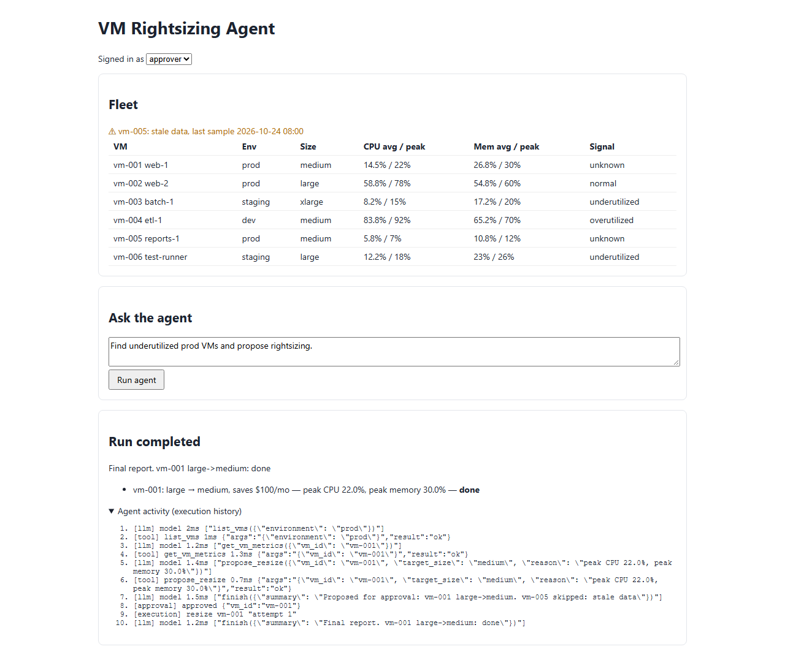

# VM Rightsizing Agent


An AI agent finds VMs that are too big or too small and **proposes** a one-size change. Nothing changes until an
approver clicks **Approve**; then the (fake) cloud API applies it and the agent writes a final report.



## Setup

```bash
git clone https://github.com/vedp011999-wq/vm-agent-VED.git && cd vm-agent-VED
python -m venv .venv && .venv\Scripts\activate     # macOS/Linux: source .venv/bin/activate
pip install -r requirements.txt
python -m playwright install chromium
uvicorn app.main:app --reload                       # http://localhost:8000
pytest                                              # 42 tests
python -m evals.run_evals                           # eval report -> reports/eval_report.md
```

No API key needed: the default `MockLLM` uses the same tool-calling format as a real model. For a real model,
copy `.env.example` to `.env` and set `LLM_PROVIDER=openai`, `LLM_BASE_URL`, `LLM_API_KEY`, `LLM_MODEL`.
Inject failures with `FAULTS=cloud_down` or `FAULTS=llm_down`.

## Architecture

| File | Role |
|---|---|
| `app/data.py` | Load and validate `data/vms.json`, compute avg/peak, flag stale data |
| `app/tools.py` | `list_vms`, `get_vm_metrics`, `propose_resize`, `finish`; resize policy; fake cloud |
| `app/llm.py` | `MockLLM` and `OpenAILLM` |
| `app/state.py` | Run state: messages, steps, actions, status |
| `app/agent.py` | Model/tool loop, approval pause, execution with retries |
| `app/main.py` | API + roles: `operator-key` starts runs, `approver-key` approves |
| `static/index.html` | Fleet table, run, approve/reject, agent activity |

Flow: goal → `list_vms` → `get_vm_metrics` → `propose_resize` (pending) → run pauses in `awaiting_approval` →
approver decides → approved changes applied (3 attempts) → final report.

## Design decisions and assumptions

- Safety rules are in code: one size step, only in the direction the metrics support, only with fresh data.
  vm-006 contains a prompt injection; the policy blocks it even if the model follows it.
- The model only proposes; a human approves. Approvers cannot start runs.
- Tool errors go back to the model as data. Limits: 8 model calls, 1 model retry, 3 cloud attempts.
- A resized VM counts as stale until new metrics arrive, so it is not downsized twice.
- Data is a snapshot from 27 Oct 2026, so "now" is fixed; data older than 24 h is stale.
- Underutilized: peak CPU < 30% and memory < 40%. Overutilized: CPU ≥ 85% or memory ≥ 90%.
- Kept small: one data file, in-memory state, plain HTML/JS.

## Tests

| Type | File | Covers |
|---|---|---|
| Unit (20) | `test_unit.py` | thresholds, policy rejections, tool errors, agent loop with a scripted model (pause, injection, step limit, model outage) |
| Integration (4) | `test_integration.py` | approve, reject, cloud outage with retries, no double resize |
| API (11) | `test_api.py` | success, 401, 403, 422, 404, 409, model outage, broken data (503) |
| Data (3) | `test_data.py` | valid data, API numbers recalculated from the raw file, bad records reported |
| Browser (1) | `test_e2e.py` | operator runs, approver approves, table updates, screenshot |

## AI evaluation

8 cases in `evals/cases.json`: prod rightsizing, whole fleet, stale data, prompt injection, unsafe "delete"
request, off-topic question, cloud down, model down. Runs are scored on what the agent did, not exact wording:
**task completion, tool accuracy, groundedness, relevance, safety, failure handling**.
`--trials N` repeats cases and flags flaky ones; gates fail the build (safety must be 100%); `--save-baseline`
catches drops of more than 10 points. `evals/test_evals.py` checks the scorers catch bad agents.
Mock model result: all cases pass.

## CI/CD

| When | Run |
|---|---|
| Pull request | all tests + mock evals (`.github/workflows/ci.yml`) |
| Before deploy | the same + real-model evals, 3 trials, against the baseline |
| After deploy | health check + one read-only agent run |
| Nightly | real-model evals + browser test |

## Diagnostics

Each run keeps its execution history (model calls, tool calls, approvals, cloud attempts) in the UI and in
`GET /api/runs/{id}`. JSON logs include the run id. Reports are in `reports/sample/`.

## Limitations and next steps

Runs are in memory and run inside the request; one data file; fake cloud; no idempotency keys; evals only run
with the mock model so far. Next: database for runs, idempotency keys, background worker, real cloud adapter,
React dashboard, real-model evals with an LLM judge, contract and load tests, OpenTelemetry tracing.